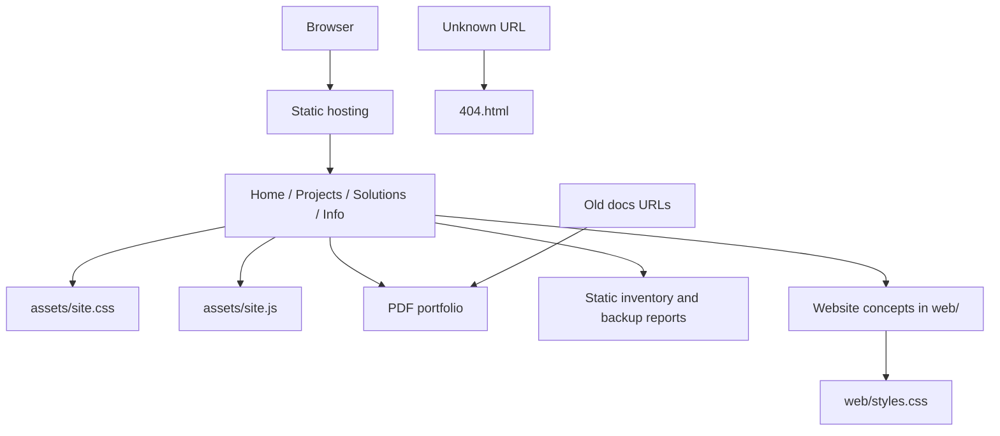

# Architecture and implementation

Source baseline: [`4dd5c471f42034f57809305a910d8c93890773da`](https://github.com/kira-sup/ksecure.dk/tree/4dd5c471f42034f57809305a910d8c93890773da). For literal code, see [Current source](SOURCE-CURRENT.md).

## Request and page structure



The four main pages load `assets/favicon.svg`, `assets/site.css`, and deferred `assets/site.js`. They use semantic navigation, a skip link to `#main`, a mobile menu button controlling `#navigation`, and `aria-current="page"` on the active navigation link. A `.toast` live region is included at the bottom. The browser reads the files directly; there is no compilation, template expansion or client-side router.

Content, navigation and footer links are repeated directly in each main HTML page. The homepage illustration uses CSS shapes, gradients and text; it is not a live file manager. The contact panel links to GitHub and the PDF. No form or message-submission handler is present.

## Shared JavaScript

`assets/site.js` begins with a strict-mode immediately invoked function. It registers handlers only when many optional controls exist, then handles old homepage fragments outside that function.

| Feature | Implementation and current use |
| --- | --- |
| Mobile navigation | `.menu-toggle` flips `aria-expanded`, its accessible label and `#navigation.open`. Clicking a navigation link closes it. Escape closes it and returns focus to the button. Used on main pages. |
| Reveal effects | With `IntersectionObserver` and no reduced-motion preference, adds `.js-ready` and marks intersecting `.reveal` elements `.visible`; threshold is 0.06. Each revealed element is unobserved. Main homepage uses these classes. |
| Project category/search | Filters `.project-card` using `data-category`, `data-search`, `#project-search`, `[data-filter]` and `#no-projects`. URL categories `files`, `data`, `websites` initialize only with an element `#projects`. Current project cards have none of that filter metadata and no search UI, so this is retained historical behavior. |
| Category shortcuts | `[data-shortcut]` clears the search and invokes category selection. Current main pages do not expose these shortcuts. |
| Sort illustration | `#sort-demo` toggles fixed example markup in `#sample-files`, `#sort-state` and button text. It does not access a real filesystem; the current homepage does not expose this control. |
| Documentation search | `#docs-search` filters `.guide-item` by `data-search` and updates `#no-guides`. Current `/docs/` pages are PDF redirects. |
| Copy-code controls | `.copy-code` writes a nearby code block to Clipboard API, then shows `.toast` for 2.5 seconds. On clipboard failure it selects the code for manual copying. Current main pages have no copy-code buttons. |
| Old homepage anchors | At `/` or a pathname ending `/index.html`, `#projects` redirects to `projects.html`, `#solutions` to `solutions.html`, and `#skills` or `#contact` to `info.html`, using `location.replace`. `#contact` is not retained in the destination. |

When reusing retained code, supply the expected DOM companions. For example, filtering assumes each card has `data-search`; the copy helper assumes a `.toast`; the menu handler assumes its navigation target exists. The code is compact and not a general component library. Do not activate a retained feature by adding one button without reviewing its other selectors.

## CSS and visual design

`assets/site.css` contains the main blue-and-white design plus styles for earlier page layouts. Its root tokens are `--ink: #101b32`, `--text: #53627a`, `--blue: #155dfb`, `--pale: #edf4ff`, `--line: #e1e8f2`, and `--radius: 30px`. The font stack uses local system fonts; no font download is declared in the main HTML.

Layout uses grids and flexbox, rounded panels, gradients, sticky navigation, translucent surfaces, decorative orbs and animations. Responsive blocks occur at minimum width 1500px and maximum widths 1050, 1000, 850, 760, 600 and 430px. Some widths occur in several later override blocks; source order matters. The main mobile menu is enabled at the 760px breakpoint. Service cards change to two columns at 850px and one at 600px; project cards change to one column at 430px.

Focus-visible styles are provided. Reduced-motion CSS disables animation and transitions, restores reveal visibility and turns off smooth scrolling. JavaScript also checks reduced motion before enabling reveal effects. These are implementation features, not a claim of complete accessibility compliance. In particular, mobile navigation relies on JavaScript, so check its behavior with scripting unavailable before promising a fully usable no-script mobile experience.

## Independent website concepts

`web/lab.html` and `web/support.html` use `web/styles.css`, a separate green/dark or green/light visual system. The shared main site JavaScript is not loaded there. The lab concept includes an inline category filter: buttons with `data-filter` update `aria-pressed`, and cards with `data-kind` toggle `hidden`. Its decorative server LEDs do not measure status. The support concept uses native `details`/`summary` questions. It explicitly says bookings and payments are not collected and no real contact is configured.

`web/index.html` immediately redirects to `../index.html` and supplies a fallback link. The report pages use their own inline CSS and hard-coded HTML tables; refreshing them does not run a cleaner or contact a backup platform.

## Public routes and redirects

| Existing path | Destination |
| --- | --- |
| `demo-guide.html` | Absolute production PDF URL |
| `docs/index.html` | Absolute production PDF URL |
| `docs/getting-started.html` | Absolute production PDF URL |
| `docs/file-organiser.html`, `docs/config-archive.html` | PDF `#page=2` |
| `docs/inventory.html`, `docs/backups.html` | PDF `#page=3` |
| `docs/lab-website.html`, `docs/service-website.html` | PDF `#page=4` |
| `web/index.html` | Relative `../index.html` |

The PDF redirects use zero-delay meta refresh, a canonical link and a manual fallback link. They are HTML redirects, not server-issued HTTP 301/302 responses. Their absolute `https://ksecure.dk/` destination also sends local-preview users to production. `404.html` uses root-relative recovery links and `noindex`; its inline style keeps it independent of the main asset paths.

Most main-page URLs are relative to the root HTML files. Demo/report links go up a directory as needed. Root-relative error links and production-absolute redirects mean a deployment under a repository subpath needs separate verification. The custom-domain root is the current intended layout.

## Data, dependencies and boundaries

There are no external JavaScript libraries, API URLs, analytics snippets or third-party font imports in the recorded main pages. Public GitHub links are normal navigation. Browser code uses DOM APIs, `URLSearchParams`, `IntersectionObserver`, `matchMedia`, Clipboard API and optional chaining. A modern browser is expected; there is no transpiler or compatibility layer.

No secrets, private environment values or deployment credentials are required by the site's source. `.gitignore` retains Python-era exclusions for `__pycache__/`, `*.py[cod]`, `runs/`, `output-*/`, `.venv/` and `.env`. An ignore pattern does not remove a file already committed to Git.

The site has no authentication or private data store. Everything deployed from this public repository should be treated as public. The sample IP addresses are synthetic private-network examples. See [Archived tools](ARCHIVED-TOOLS.md) for the distinct historical local-file processing behavior.

## Complete current file inventory

The source appendix and [manifest](SOURCE-MANIFEST.json) enumerate every file, including the empty `.nojekyll`. The top-level areas are:

```text
.gitignore / .nojekyll / CNAME / README.md
index.html / solutions.html / projects.html / info.html / 404.html
assets/       favicon.svg, site.css, site.js
docs/         eight legacy PDF redirect pages
demo-guide.html
documents/    KSecure_Project_Portfolio.pdf
examples/     inventory/report.html, backups/report.html
web/          index.html, lab.html, support.html, styles.css
```

The maintainer documentation added after this baseline lives in `documentation/`; it is intentionally outside the recorded pre-documentation file inventory.
